# 화면으로 보는 Folane 사용법

> **예시 화면이에요.** 아래 그림은 모두 시험용 문서(`sample.pdf`)를 열고, 시험용 가짜 AI 서버에 연결해서 찍었어요. 그래서 AI 답, 받아 적은 글, 자막, 번역에 보이는 글(예: `[가짜 gemini]`, `가짜 자막 1번째 마디`)은 실제 AI가 쓴 글이 아니에요. 실제로 쓸 때는 연결한 AI가 쓴 글이 그 자리에 나와요. 버튼 자리와 화면 구성은 1.18.1 기준이에요.

## 시작 화면

PDF를 열기 전 첫 화면에서 지금 버전, 업데이트, 지금 쓰는 AI, 읽기 목소리를 한눈에 봐요. `업데이트 확인`을 누르면 바로 새 버전을 찾아요.

| 맥 | 안드로이드 |
|---|---|
| 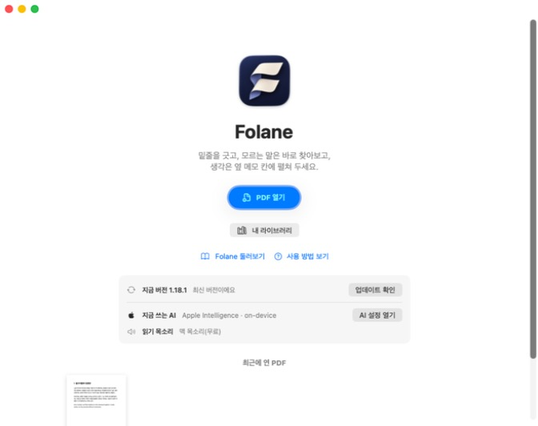 | 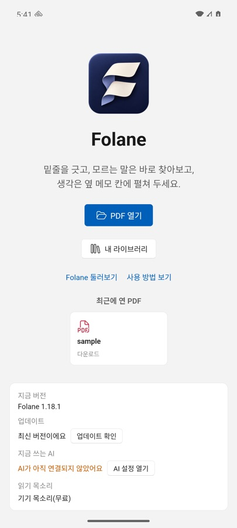 |

## 밑줄 긋고 찾아보기

낱말에 밑줄을 그으면 오른쪽 메모 칸에 위키백과 설명이 펼쳐지고, 펜이나 하이라이트로 그은 표시는 PDF 안에 저장돼요. 펜을 고르면 위쪽에 색과 굵기를 고르는 막대가 떠요.

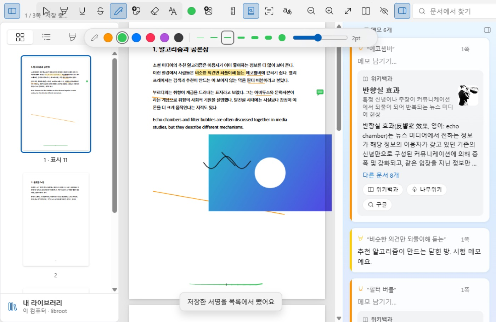

## 그리기 도구를 원하는 자리에

툴바 꾸미기의 `그리기 도구 놓을 곳`에서 `떠 있는 막대로`를 고르면 도구가 문서 위에 떠요. ⠿를 끌어 옮기고 ⇄로 가로·세로를 바꿔요. 작게 접으려면 –를 눌러요. 맥은 보기 메뉴에서도 바꾸고, 휴대폰은 처음부터 떠 있는 막대로 나와요.

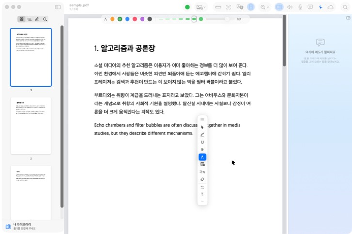

## 인공지능에 물어보기

오른쪽 칸에서 고른 부분, 이 쪽, 앞뒤 쪽, 문서 전체 가운데 범위를 골라 요약하거나 질문해요. 칸 왼쪽 가장자리를 끌면 너비가 바뀌어요.

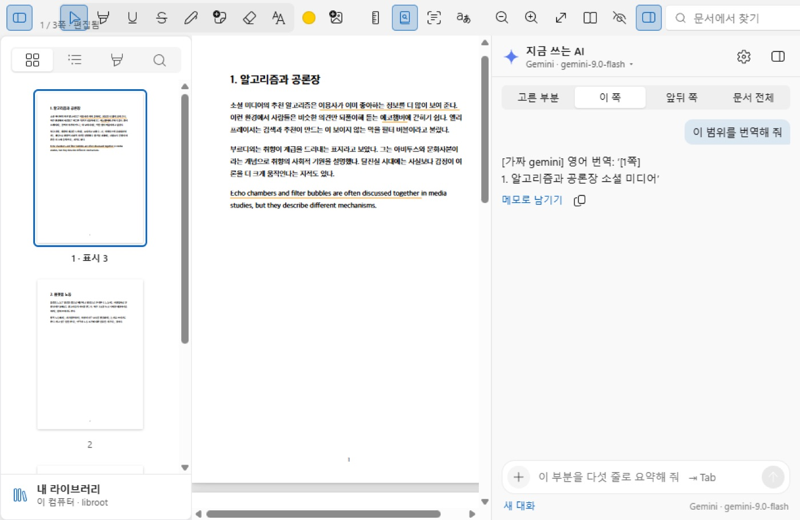

## 문서 번역: 번역한 쪽만 받기

`범위`에서 일부 쪽만 고르면 `받을 파일`이 켜져요. `번역한 쪽만`(기본)을 두면 그 쪽만 담은 PDF가, `문서 전체`를 고르면 나머지 쪽은 원문 그대로 둔 전체 파일이 나와요.

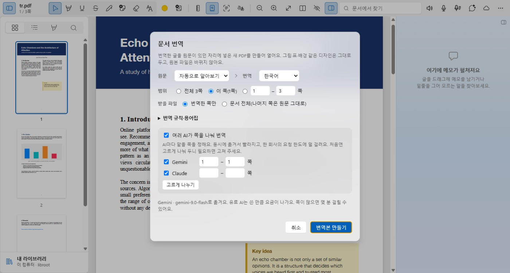

## 녹음하면서 실시간 자막

메모 카드에서 녹음하는 동안 들리는 말이 글자로 뜨고, 그 밑에 고른 언어로 옮긴 글이 붙어요. `자막 끄기`로 끄고, `→ 한국어` 칸에서 번역 언어를 바꿔요. 녹음을 마치면 자막이 `■ 실시간 자막` 아래 메모로 남아요.

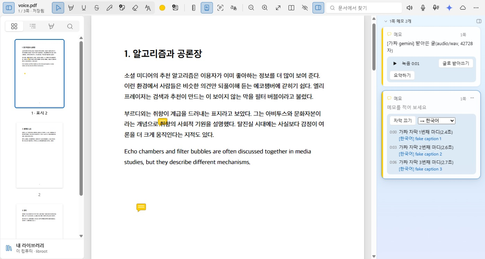

## 녹음을 글로 받고 요약하기

`글로 받아쓰기`를 누르면 녹음을 글로 받아 메모에 넣어요. 긴 녹음은 문단마다 `[12:30]` 같은 녹음 시각이 붙고, 받는 동안 카드에 남은 시간이 나와요. `요약하기`를 누르면 AI가 요지와 흐름을 정리하고, `요약을 메모에 넣기`로 메모 맨 위에 둬요.

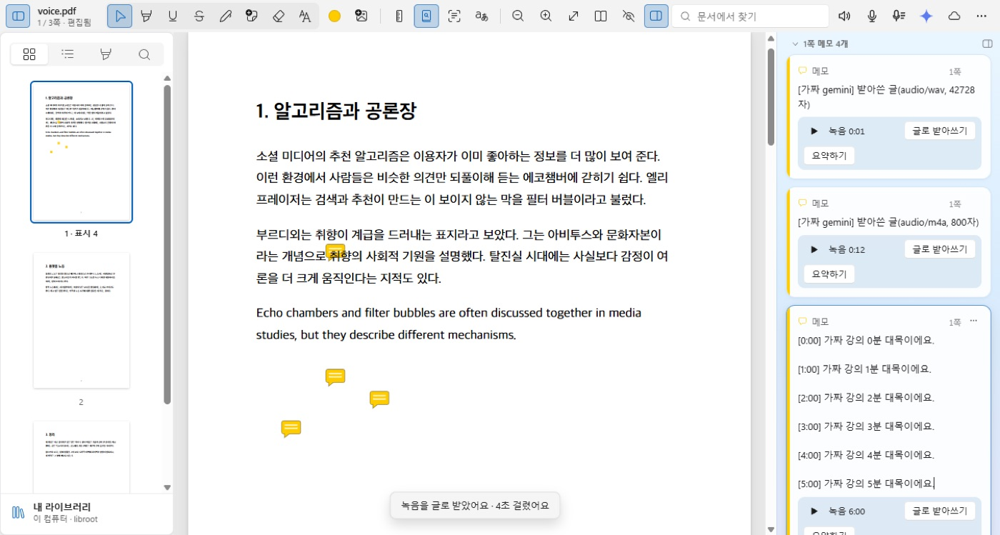

## 읽을 범위 골라 소리로 듣기

툴바의 스피커 단추를 누르면 `이 쪽 읽기`, `여기부터 끝까지 읽기`, `읽을 범위 고르기…`가 나와요. 범위 창에서 쪽을 정해 소리로 듣거나 소리 파일로 저장해요. 쪽수·각주·서지 줄은 건너뛰고 본문만 읽어요.

| 윈도우 | 안드로이드 |
|---|---|
| 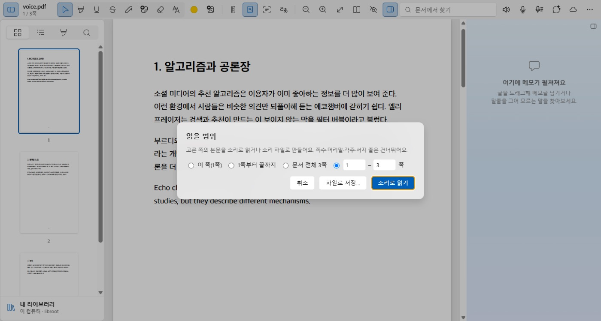 | 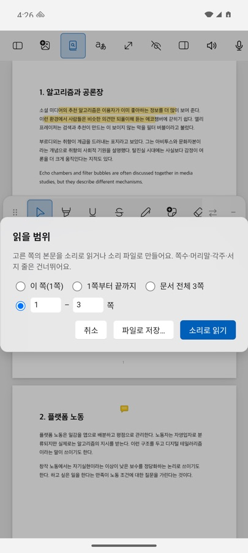 |

## 휴대폰: 메모·번역 칸 옮기기

휴대폰에서는 메모 칸과 AI 칸이 화면 아래쪽 반에 떠서 문서를 가리지 않아요. 위쪽 손잡이를 끌어 옮기고, 오른쪽 아래 모서리를 끌어 크기를 바꿔요. `아래`·`옆`·`크게` 단추로 자리를 한 번에 정할 수도 있어요.

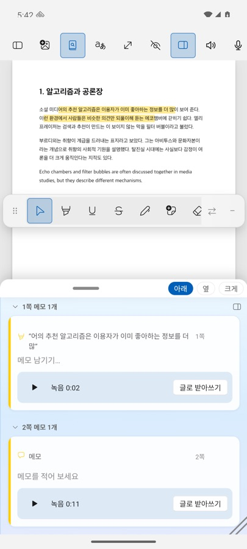

---

더 자세한 설명은 앱의 `사용 방법 보기`와 [README](../README.md)에 있어요.
